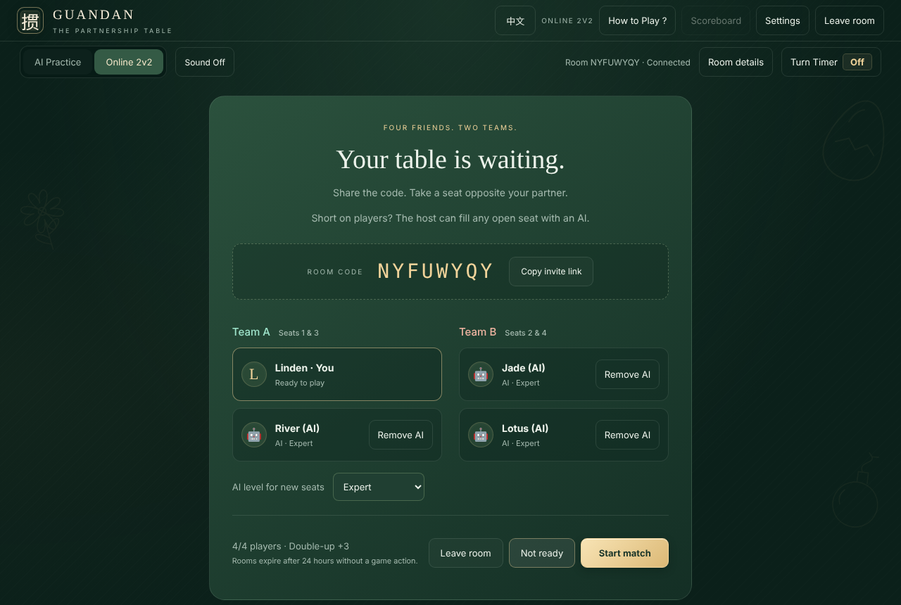

# Project Guandan: The Partnership Card Game, Online and Against AI

A complete, bilingual (English / 简体中文) version of **Guandan (掼蛋)**, the four-player
partnership climbing game: play with friends in private online rooms, fill empty seats
with AI players, or practice against four levels of AI in the browser.

*Linden Wang · Fall 2026*

**Play Now (Practice vs. AI):** https://lindenwang1.github.io/Guandan/



## Results: The AI Ladder

Every AI level beats the one below it. Win rates come from `ai/arena.mjs`: 1,000 hands
per pairing, and every deal is replayed with the teams swapped, so neither side gets
luckier cards.

| Matchup | Higher level wins | Net levels gained per hand |
| --- | --- | --- |
| Expert vs Hard | **70.9%** | +1.12 |
| Expert vs Medium | **88.1%** | +2.19 |
| Expert vs Beginner | **96.3%** | +2.68 |
| Hard vs Medium | 73.8% | +1.33 |
| Hard vs Beginner | 85.2% | +2.02 |
| Medium vs Beginner | 70.4% | +1.23 |

Reproduce any row exactly: `node ai/arena.mjs expert hard 500` (level names: `easy` = Beginner,
`normal` = Medium, `hard`, `expert`).

## The Game

Two teams of two, partners sitting opposite. Each player gets 27 cards from two decks.
Lead any combination (single, pair, triple, full house, straight, tube, plate) and
the others must beat it with the same shape or a bomb. The first team to empty both
hands climbs levels, 2 → A, and a team wins the match by winning at Ace. The level card
of hearts is wild. The full rules are in the game under **How to Play**.

## What's in It

- **AI Practice.** You plus three AI players, entirely in the browser. Saves progress,
  pauses when the tab is hidden, and keeps statistics.
- **Online 2v2.** Private rooms with an 8-character code or invite link. The server
  checks every move, and each player only ever receives their own hand. Reloading reconnects to
  your seat. Spectator links, emotes, a turn timer and a running scoreboard are included.
- **AI Players in Online Rooms.** The host can put a Beginner, Medium, Hard or Expert AI
  in any open seat, so one to three people can still play a full table.
- **Four AI Levels.** Beginner often plays a random legal move. Medium balances its
  cards and protects its partner's lead. Hard also avoids breaking up useful
  combinations. Expert plans its whole hand, tracks every card played, and saves bombs.
- **Built for the Table.** English/Chinese toggle per player, card grouping, hints,
  keyboard shortcuts, sound cues, three table themes, a dealing animation, and place
  medals. Reduced-motion settings are respected.

## Why It's Built This Way

- **One Rules Engine Everywhere.** `dist/engine.js` decides what is legal for the
  practice game, the online server and the AI alike, so they can never disagree.
- **The Server Is the Referee.** Online, the browser only sends "play these cards".
  `server/rooms.js` validates the move, versions every change, and rejects duplicates
  and stale actions. Each request returns only the asking player's own hand.
- **AI That Does Not Cheat.** Every AI sees only what a person would: its own hand,
  the card counts, and the cards already played. A test hides other hands and checks
  that every decision stays the same.
- **Expert Is Explainable.** It splits the hand into the fewest plays, uses played
  cards to find leads nobody can beat, saves bombs for when an opponent is close to
  finishing, and feeds a partner who is nearly out. Every tuning number is in
  `DEFAULT_WEIGHTS` in `dist/expert-ai.js`.
- **No Framework, No Build Step for the Site.** Plain HTML, CSS and JavaScript modules.
  esbuild is used only to bundle the Cloudflare Worker and the single-file demo.

## Quick Start

Needs Node.js 24+ and pnpm 11.25.0 (`npm install -g pnpm@11.25.0`).

```bash
pnpm install --frozen-lockfile
pnpm start            # http://127.0.0.1:4174, with practice AND online rooms (local database)
pnpm test             # 100 tests: rules, AI, online rooms, AI seats, translations
pnpm arena            # Expert vs Hard AI match; or: node ai/arena.mjs expert medium 300
pnpm build:demo       # demo/guandan-demo.html, a single file you can open anywhere
```

To play online with friends on other devices, deploy to Cloudflare (free tier): see
[`docs/DEPLOY.md`](docs/DEPLOY.md).

## Next: Training a Better AI

The arena is set up so a trained AI can be compared directly with the hand-written ones:
`playHand` and `match` accept any function `(game, seat) => move`.

1. **Tune Expert's weights with self-play.** Search over `DEFAULT_WEIGHTS` (random
   search or CMA-ES) to maximize win rate against the current Expert.
2. **Learn a move scorer.** Log `(state features, move, eventual result)` from
   self-play, train a small model, and export its weights as JSON so the browser can run it.
3. **Reinforcement learning (stretch goal).** DanZero (Lu et al., 2022) trained a Guandan
   AI with Deep Monte-Carlo self-play, which took about 30 days on 160 CPUs and 1 GPU.

## Status

| Piece | State |
| --- | --- |
| Rules engine: all combinations, wild cards, bombs, tribute, levels to Ace | Done; tested |
| AI Practice with save/resume and statistics | Done |
| Online 2v2 rooms (Cloudflare Worker + D1), spectators, turn timer, scoreboard | Done; tested |
| AI players in online seats | Done; tested |
| Expert AI and Beginner / Medium / Hard / Expert tiers | Done; ladder measured |
| AI arena (`ai/arena.mjs`) | Done |
| GitHub Pages practice site, CI on every push | Done |
| Self-play weight tuning | Next |
| Learned move-scoring model | Next |

## Layout

```
dist/              the website (edited directly, not generated, apart from dist/server/)
  engine.js          rules, legal moves, Beginner/Medium/Hard AI, game state
  expert-ai.js       Expert AI: hand planning, card tracking, DEFAULT_WEIGHTS
  app.js             table interface (practice and online)
  online.js          room connection, saved seat, retries
  i18n.js, rules.js  English/Chinese text and the How to Play guide
  ...                hand grouping, scoreboard, timer, emotes, sound, preferences
server/            online room API (rooms.js), Cloudflare Worker entry, local SQLite adapter
ai/arena.mjs       AI vs AI matches with mirrored deals
db/, drizzle/      database schema and migrations
*.test.mjs         100 automated tests
docs/              deployment guide, file guide, earlier changelog, review notes, screenshots
.github/workflows/ ci.yml (tests) and pages.yml (practice site)
```

## References

- Lu, Zhao, Zhao, Zhou & Li (2022), *DanZero: Mastering GuanDan Game with Reinforcement Learning*, arXiv:2210.17087.
- Zhao, Lu, Zhao, Zhou & Li (2023), *DanZero+: Dominating the GuanDan Game through Reinforcement Learning*, arXiv:2312.02561.

## License

MIT (see `LICENSE`).
