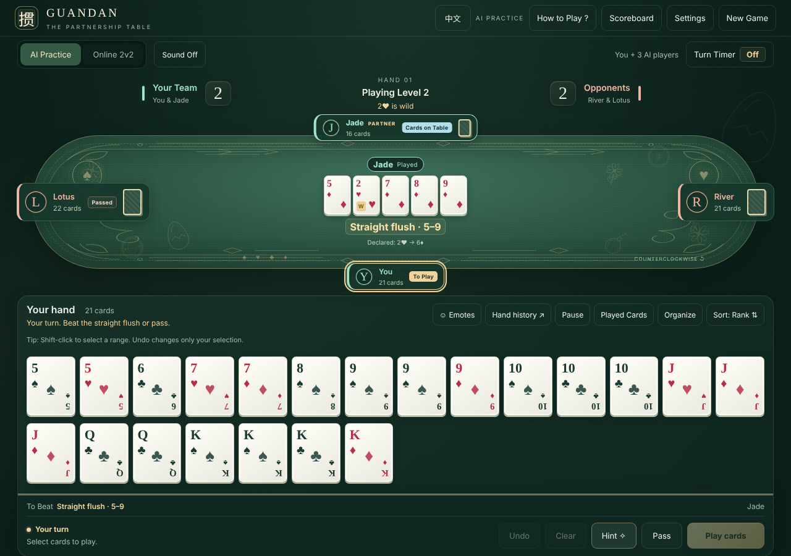

# Project Guandan: The Partnership Card Game, Online and Against AI

A complete, bilingual (English / 简体中文) version of **Guandan (掼蛋)**, the four-player
partnership climbing game: play with friends in private online rooms, or practice against
AI players in the browser.

*Linden Wang · Fall 2026*

**Play Now (Practice vs. AI):** https://lindenwang1.github.io/Guandan/



## The Game

Two teams of two, partners sitting opposite. Each player gets 27 cards from two decks.
Lead any combination (single, pair, triple, full house, straight, tube, plate) and
the others must beat it with the same shape or a bomb. The first team to empty both
hands climbs levels, 2 → A, and a team wins the match by winning at Ace. The level card
of hearts is wild. The full rules are in the game under **How to Play**.

## What's in It

- **AI Practice.** You plus three AI players (Easy, Normal or Hard), entirely in the
  browser. Saves progress, pauses when the tab is hidden, and keeps statistics.
- **Online 2v2.** Private rooms with an 8-character code or invite link. The server
  checks every move, and each player only ever receives their own hand. Reloading
  reconnects to your seat. Spectator links, emotes, a turn timer and a running
  scoreboard are included.
- **Built for the Table.** English/Chinese toggle per player, card grouping, hints,
  keyboard shortcuts, sound cues and three table themes. Reduced-motion settings are
  respected.

## Why It's Built This Way

- **One Rules Engine Everywhere.** `dist/engine.js` decides what is legal for the
  practice game, the online server and the AI alike, so they can never disagree.
- **The Server Is the Referee.** Online, the browser only sends "play these cards".
  `server/rooms.js` validates the move, versions every change, and rejects duplicates
  and stale actions. Each request returns only the asking player's own hand.
- **AI That Does Not Cheat.** The AI sees only what a person would: its own hand and
  the card counts. A test hides the other hands and checks that its decisions stay the same.
- **No Framework, No Build Step for the Site.** Plain HTML, CSS and JavaScript modules.
  esbuild is used only to bundle the Cloudflare Worker and the single-file demo.

## Quick Start

Needs Node.js 24+ and pnpm 11.25.0 (`npm install -g pnpm@11.25.0`).

```bash
pnpm install --frozen-lockfile
pnpm start            # http://127.0.0.1:4174, with practice AND online rooms (local database)
pnpm test             # rules, AI, online rooms, translations, UI models
pnpm build:demo       # demo/guandan-demo.html, a single file you can open anywhere
```

To play online with friends on other devices, deploy to Cloudflare (free tier): see
[`docs/DEPLOY.md`](docs/DEPLOY.md).

## Status

| Piece | State |
| --- | --- |
| Rules engine: all combinations, wild cards, bombs, tribute, levels to Ace | Done; tested |
| AI Practice with save/resume and statistics | Done |
| Online 2v2 rooms (Cloudflare Worker + D1), spectators, turn timer, scoreboard | Done; tested |
| GitHub Pages practice site, CI on every push | Done |
| Stronger "Expert" AI and an AI-vs-AI arena | Next |
| AI players in online seats | Next |
| Table animations and polish | Next |

## Layout

```
dist/              the website (edited directly, not generated, apart from dist/server/)
  engine.js          rules, legal moves, AI, game state
  app.js             table interface (practice and online)
  online.js          room connection, saved seat, retries
  i18n.js, rules.js  English/Chinese text and the How to Play guide
  ...                hand grouping, scoreboard, timer, emotes, sound, preferences
server/            online room API (rooms.js), Cloudflare Worker entry, local SQLite adapter
db/, drizzle/      database schema and migrations
*.test.mjs         automated tests
docs/              deployment guide, file guide, earlier changelog, review notes, screenshots
.github/workflows/ ci.yml (tests) and pages.yml (practice site)
```

## License

MIT (see `LICENSE`).
